<p align="center">
  
</p>

<p align="center">
  <a href="https://github.com/ishandutta2007/Awesome-Awesome-Awesome"></a>
  <a href="https://discord.gg/jc4xtF58Ve"></a>
  <a href="https://github.com/ishandutta2007/Awesome-Synthetic-Code-Generation-Compilers/stargazers"></a>
  <a href="https://github.com/ishandutta2007/Awesome-Synthetic-Code-Generation-Compilers/network/members"></a>
  <a href="https://github.com/ishandutta2007/Awesome-Synthetic-Code-Generation-Compilers/blob/main/LICENSE"></a>
  <a href="https://github.com/ishandutta2007/Awesome-Synthetic-Code-Generation-Compilers/pulls"></a>
  <a href="https://github.com/ishandutta2007"></a>
</p>

---

# 🚀 Awesome-Synthetic-Code-Generation-Compilers: Autonomous Coding Agents, Code Synthesis & Native Toolchains

> **The definitive curated directory of SaaS platforms, autonomous AI software engineers, foundation models, and open-source GitHub projects powering the next generation of Synthetic Code Generation Compilers.**

---

## 📑 Table of Contents

- [🔍 Overview & Core Concepts](#-overview--core-concepts)
- [📊 Sector Overview & Market Dynamics](#-sector-overview--market-dynamics)
- [☁️ SaaS & Hosted Platforms](#️-saas--hosted-platforms)
- [💻 Open-Source GitHub Projects](#-open-source-github-projects)
- [🛠️ Architectural Patterns for Custom Synthetic Compilers](#️-architectural-patterns-for-custom-synthetic-compilers)
- [🤝 How to Contribute](#-how-to-contribute)
- [💖 Support & Sponsoring](#-support--sponsoring)
- [📈 Star History](#-star-history)
- [⚖️ Disclaimer](#️-disclaimer)

---

## 🔍 Overview & Core Concepts

**Synthetic Code Generation Compilers** represent the paradigm shift from line-by-line autocomplete toward **autonomous, agentic software synthesis**. Unlike traditional language parsers and simple LLM code completions, synthetic code compilers:

- 🧠 **Ingest Multi-Modal Specifications**: Understand software requirements, system architectures, API schemas, and visual mockups from natural language prompts.
- 🌳 **Model Codebase Context Globally**: Build semantic repository maps, abstract syntax trees (ASTs), and dependency graphs across thousands of files.
- ⚡ **Execute Autonomous Build Loops**: Spin up sandboxed execution runtimes, invoke build systems (`cargo`, `npm`, `cmake`, `pytest`), inspect compiler and linter errors, and self-correct until all tests pass.
- 📦 **Produce Production-Ready Artifacts**: Emit atomic git commits, verified pull requests, cloud infrastructure deployments, and Docker containers with complete provenance.
- 🌐 **Native Toolchain & Model Context Protocol (MCP)**: Interface directly with language servers (LSP), debuggers, database migrations, and external APIs without human intervention.

---

## 📊 Sector Overview & Market Dynamics

* **📈 Estimated Market Size & Growth Runway**: The global AI code generation and autonomous developer tooling market was valued at **$4.8 Billion in 2024** and is projected to expand to **$29.5 Billion by 2032**, compounding at a CAGR of **~25.8%**. Within this landscape, agentic code synthesis platforms and autonomous code generation compilers represent the fastest-growing vector (projected at **>40% CAGR**), accelerating the transition from manual syntax coding to intent-driven software synthesis.
* **🌐 Market Fragmentation & Competitive Dynamics**: The sector is **moderately to highly fragmented** rather than a winner-take-all monopoly. While frontier foundation model providers (OpenAI, Anthropic, Google, DeepSeek) supply core reasoning compute, the developer execution harness is actively contested across distinct architectural layers:
  1. **Agentic IDEs** (Cursor, Windsurf) embedding low-latency local context engines directly in editor workspaces.
  2. **Autonomous Cloud Software Engineers** (Devin) executing long-horizon asynchronous task loops in isolated cloud containers.
  3. **In-Browser Instant Full-Stack Compilers** (Bolt.new, Lovable, v0) democratizing immediate prompt-to-app prototyping.
  4. **Self-Hosted Open-Source Frameworks** (OpenHands, Cline, Aider) driving data sovereignty, multi-model Bring-Your-Own-Key (BYOK) adoption, and custom enterprise toolchain extensions. Enterprise security mandates, IP isolation, and multi-model routing continue to prevent single-vendor capture.

---

## ☁️ SaaS & Hosted Platforms

A curated comparison of leading commercial platforms for synthetic code generation and autonomous agent execution. **Sorted in descending order by Company Size (Valuation / Revenue).**

| 🏢 Platform / Product | 💰 Company Valuation / Revenue | 💳 Starting Tier Pricing | 🎁 Free Tier / Trial Limit | 🚀 Key Capabilities & Agent Architecture |
| :--- | :--- | :--- | :--- | :--- |
| **[v0 by Vercel](https://v0.app/)** | **~$3.25B Valuation**<br>*(~$100M+ ARR)* | **$20 / month**<br>*(Premium Plan · $20 monthly usage credits)* | **Free Forever Plan** ($0/mo) with **$5 monthly credits** and a strict rate limit of ~7 messages/day | Conversational generative UI/UX & full-stack React / Next.js 16 synthesis with shadcn/ui, Tailwind CSS, live previews, and Model Context Protocol (MCP) server integration. |
| **[Poolside](https://poolside.ai/)** | **~$3.0B Valuation**<br>*(~$500M Series B · Bain Capital)* | **$0.06 / 1M input tokens**<br>*(Laguna XS 2.1 via API; enterprise on quote)* | **Free Open-Weights** under OpenMDW-1.1 license (Laguna S 2.1 & XS 2.1) + rate-limited community API endpoints | Pre-trained foundation models tailored from scratch for software engineering; 1M token context window, `pool` CLI terminal agent, and air-gapped VPC deployments. |
| **[Cursor](https://cursor.com/)** | **~$2.5B Valuation**<br>*(Anysphere · $100M+ ARR · Benchmark)* | **$20 / month**<br>*(Pro Plan · 500 fast requests/mo, Composer agent)* | **Free Forever Plan** (Hobby) with **2,000 code completions/month** + 50 slow agent requests, plus **14-day Pro trial** | Category-defining AI code editor; multi-file Composer agent, local codebase semantic indexing, terminal command execution loops, and privacy-first enterprise mode. |
| **[Devin (Cognition)](https://cognition.com/)** | **~$2.0B Valuation**<br>*(Founders Fund · FedRAMP High In-Process)* | **$20 / month**<br>*(Pro Plan · frontier models, Devin Cloud agent)* | **Free Forever Plan** ($0/mo) with light autonomous agent quota, unlimited inline edits, and unlimited Tab completions | The first autonomous AI software engineer; end-to-end plan/build/test loops, automated PR generation, FedRAMP High In-Process compliance, and legacy codebase modernization. |
| **[Magic.dev](https://magic.dev/)** | **~$1.5B Valuation**<br>*(~$465M raised · Eric Schmidt & Nat Friedman)* | **Enterprise Preview**<br>*(Custom infrastructure pricing on invitation)* | **Free Developer Research Preview** upon waitlist approval with 100M token context access | Ultra-long context (100M tokens) reasoning models powered by LTM-2-mini architecture; whole-repository synthesis and HashHop benchmark validation. |
| **[Windsurf (Cognition)](https://windsurf.com/)** | **~$1.25B Valuation**<br>*(acquired by Cognition · formerly Codeium)* | **$20 / month**<br>*(Pro Plan · enhanced daily/weekly Cascade quotas)* | **Free Forever Plan** ($0/mo) with **unlimited Tab completions**, unlimited inline edits, and light Cascade agent preview | Collaborative agentic IDE; Cascade multi-file flow, named rewindable checkpoints, AGENTS.md directory-level context rules, and SWE-1.6 frontier models. |
| **[Replit Agent](https://replit.com/)** | **~$1.16B Valuation**<br>*(Series B Extension · a16z & Khosla)* | **$25 / month**<br>*($18/mo billed annually for Core · $20/mo AI credits)* | **Free Forever Plan** (Starter) with 0.5 vCPU, 512MB RAM, daily free Agent credits resetting daily, 1 public deployment | Conversational prompt-to-production web and backend apps; in-browser execution containers, Design Canvas, parallel task execution, and rollback checkpoints. |
| **[Augment Code](https://augmentcode.com/)** | **~$977M Valuation**<br>*(~$227M Series B · Sutter Hill)* | **$20 / month**<br>*(Indie Plan · 40,000 credits / ~125 user messages)* | **Free Trial** with **30,000 trial credits** upon account registration with payment method | Context engine for enterprise codebases; semantic codebase analysis delivering 70-80% accuracy gains across multi-repository workspaces. |
| **[Bolt.new (StackBlitz)](https://bolt.new/)** | **~$700M Valuation**<br>*(~$40M+ ARR run-rate · Greylock)* | **$9 / month**<br>*(Bolt Lite) or **$25 / month** (Pro Plan · 10M tokens)* | **Free Forever Plan** ($0/mo) with **1M tokens/month** (max 300K/day), unlimited databases, and Bolt-badged web hosting | In-browser WebContainers running complete Node.js environments, live Vite previews, multi-tenant databases, and instant multi-framework full-stack app scaffolding. |
| **[Lovable](https://lovable.dev/)** | **~$200M Valuation**<br>*(Series A stage · ~$13.5M+ raised · $10M+ ARR)* | **$25 / month**<br>*(Pro Plan · 100 monthly credits with 1-month rollover)* | **Free Forever Plan** ($0/mo) with **5 daily build credits** (~30/month) + 20 cloud credits grant on lovable.app subdomain | Prompt-to-fullstack-app builder; Lovable Cloud backend with managed Supabase PostgreSQL, authentication, storage, and visual design canvas. |

---

## 💻 Open-Source GitHub Projects

Explore the leading open-source repositories powering autonomous coding agents, terminal developer companions, self-hosted Copilot alternatives, and synthetic compiler toolchains. **Sorted in descending order by GitHub Stars_Count.**

### 1. ⚡ [OpenCode](https://github.com/anomalyco/opencode) [](https://github.com/anomalyco/opencode/stargazers)
* **Description**: Terminal-native AI coding agent built for raw developer speed. Completely free with Bring-Your-Own-Key (BYOK) architecture across 75+ model providers via the AI SDK and Models.dev catalog. Features native remote/SSH support and OpenCode Zen for intelligent model routing.
* **Tech Stack**: TypeScript, Go, AI SDK, Models.dev
* **License**: MIT

### 2. 🤖 [AutoGPT](https://github.com/Significant-Gravitas/AutoGPT) [](https://github.com/Significant-Gravitas/AutoGPT/stargazers)
* **Description**: The pioneering open-source autonomous agent framework. Features a modular block-based agent builder, long-horizon goal decomposition, integrated memory systems, and automated command execution loops for multi-step software synthesis.
* **Tech Stack**: Python, TypeScript, Docker, Poetry
* **License**: MIT

### 3. 👐 [OpenHands](https://github.com/OpenHands/OpenHands) [](https://github.com/OpenHands/OpenHands/stargazers)
* **Description**: SOTA platform for building and running autonomous AI coding agents. Provides sandboxed Docker execution environments, multi-session agent management, universal agent controllers, and scored over 77% on SWE-Bench. Demonstrated end-to-end compiler synthesis (`ralph-cc-go`).
* **Tech Stack**: Python, Docker, React, FastAPI
* **License**: MIT

### 4. 🏢 [MetaGPT](https://github.com/FoundationAgents/MetaGPT) [](https://github.com/FoundationAgents/MetaGPT/stargazers)
* **Description**: Multi-agent collaborative meta-programming framework that simulates an entire software company. Assigns specialized roles (Product Manager, System Architect, Project Manager, Engineer, QA) to LLMs to output PRDs, design diagrams, API specs, and clean source code from a one-line prompt.
* **Tech Stack**: Python, Multi-Agent Orchestration, Mermaid
* **License**: MIT

### 5. 🧑‍💻 [Cline](https://github.com/cline/cline) [](https://github.com/cline/cline/stargazers)
* **Description**: Open-source autonomous coding agent for VS Code, JetBrains, Cursor, Windsurf, and CLI. Model-unrestricted (Claude, GPT, Gemini, local Ollama) with the most mature Model Context Protocol (MCP) toolchain integration and human-in-the-loop permission safeguards.
* **Tech Stack**: TypeScript, VS Code Extension API, MCP
* **License**: Apache-2.0

### 6. 🪿 [Goose](https://github.com/aaif-goose/goose) [](https://github.com/aaif-goose/goose/stargazers)
* **Description**: Rust-based open-source autonomous AI agent from Block, now hosted under the Agentic AI Foundation at the Linux Foundation. Desktop application and CLI connecting to 15+ providers and 70+ extensions over Model Context Protocol (MCP) for coding, debugging, and workflow automation.
* **Tech Stack**: Rust, MCP, Tauri, Tokio
* **License**: Apache-2.0

### 7. 🛠️ [gpt-engineer](https://github.com/AntonOsika/gpt-engineer) [](https://github.com/AntonOsika/gpt-engineer/stargazers)
* **Description**: Groundbreaking CLI platform that specifies, structures, and synthesizes entire codebases from natural language descriptions. Interactively clarifies ambiguities before writing code, creating a reproducible blueprint for automated development.
* **Tech Stack**: Python, Typer, OpenAI API
* **License**: MIT

### 8. 💻 [Aider](https://github.com/Aider-AI/aider) [](https://github.com/Aider-AI/aider/stargazers)
* **Description**: Terminal-based AI pair programming tool with best-in-class git integration. Automatically maps repository structures via Tree-sitter, performs multi-file code modifications, and executes automatic linter and test self-correction loops before generating clean git commits.
* **Tech Stack**: Python, GitPython, Tree-sitter
* **License**: Apache-2.0

### 9. 🔄 [Continue.dev](https://github.com/continuedev/continue) [](https://github.com/continuedev/continue/stargazers)
* **Description**: Open-source AI code assistant for VS Code and JetBrains. Features model-agnostic BYOK architecture supporting any cloud or local LLM (Ollama, LM Studio), tab autocomplete, custom slash commands, and source-controlled AI checks enforceable directly in CI/CD.
* **Tech Stack**: TypeScript, Python, React
* **License**: Apache-2.0

### 10. 🐱 [Tabby](https://github.com/TabbyML/tabby) [](https://github.com/TabbyML/tabby/stargazers)
* **Description**: Self-hosted, on-premises alternative to GitHub Copilot. Packaged as a single self-contained Rust binary with no DBMS required, consumer-grade GPU support, and built-in Answer Engine for internal knowledge retrieval and codebase indexing.
* **Tech Stack**: Rust, ONNX Runtime, CUDA, ROCm
* **License**: Apache-2.0

### 11. 🧭 [Pythagora GPT-Pilot](https://github.com/Pythagora-io/gpt-pilot) [](https://github.com/Pythagora-io/gpt-pilot/stargazers)
* **Description**: Autonomous AI developer that builds production web applications step by step from a functional specification. Interacts with the human developer for architecture confirmation and runs real execution tests to verify every generated module.
* **Tech Stack**: Python, JavaScript, VS Code Extension
* **License**: MIT

### 12. ⚡ [Kilo Code](https://github.com/Kilo-Org/kilocode) [](https://github.com/Kilo-Org/kilocode/stargazers)
* **Description**: Free and open-source coding extension for VS Code, JetBrains, and CLI supporting 500+ models. Features transparent zero-markup API passthrough, flexible BYOK options, and shared team configuration without requiring proprietary subscription plans.
* **Tech Stack**: TypeScript, VS Code API
* **License**: MIT

### 13. 🦘 [Roo Code](https://github.com/RooCodeInc/Roo-Code) [](https://github.com/RooCodeInc/Roo-Code/stargazers)
* **Description**: Autonomous AI dev team extension inside VS Code. Provides role-based agent personas (Architect, Code, Ask, Debugger, Test), deep Model Context Protocol (MCP) server support, custom system prompts, and granular diff inspections.
* **Tech Stack**: TypeScript, VS Code Extension API, MCP
* **License**: Apache-2.0

### 14. 🖥️ [Dyad](https://github.com/dyad-sh/dyad) [](https://github.com/dyad-sh/dyad/stargazers)
* **Description**: Local-first, open-source desktop AI application builder that compiles and executes web projects directly on your workstation using your personal API keys. Ensures zero cloud telemetry and maximum data privacy.
* **Tech Stack**: TypeScript, Electron, React
* **License**: MIT

### 15. 🧠 [Devika](https://github.com/stitionai/devika) [](https://github.com/stitionai/devika/stargazers)
* **Description**: Open-source agentic software engineer capable of understanding complex user requests, breaking them into sequential tasks, conducting web research via Playwright browser automation, and writing complete project codebases.
* **Tech Stack**: Python, TypeScript, Playwright, React
* **License**: MIT

### 16. 📋 [Plandex](https://github.com/plandex-ai/plandex) [](https://github.com/plandex-ai/plandex/stargazers)
* **Description**: Terminal-based AI coding engine built for complex software engineering tasks. Executes in isolated sandboxes with git-style branching, multi-stage planning, diff inspection, and safe rollback capabilities.
* **Tech Stack**: Go, Tree-sitter, Git
* **License**: AGPL-3.0

### 17. 👶 [smol developer](https://github.com/smol-ai/developer) [](https://github.com/smol-ai/developer/stargazers)
* **Description**: Minimal, transparent prototype of an autonomous software developer. Synthesizes an entire multi-file codebase from a single product specification in under 200 lines of clean Python code.
* **Tech Stack**: Python, OpenAI API
* **License**: MIT

### 18. 🧹 [Sweep](https://github.com/sweepai/sweep) [](https://github.com/sweepai/sweep/stargazers)
* **Description**: Autonomous AI junior developer that turns GitHub issues into tested pull requests. Runs automatically within GitHub Actions, parses CI error logs, and writes clean code patches with unit tests.
* **Tech Stack**: Python, GitHub API, Tree-sitter
* **License**: AGPL-3.0

### 19. 🧱 [Totalum AI App Builder](https://github.com/totalumlabs/ai-app-builder-open) [](https://github.com/totalumlabs/ai-app-builder-open/stargazers)
* **Description**: Open-source prompt-to-app builder producing production Next.js 16 full-stack web applications with built-in sandbox execution, database provisioning, auth, and bidirectional GitHub sync.
* **Tech Stack**: TypeScript, Next.js 16, React 19, Tailwind 4
* **License**: MIT

### 20. 🐳 [Singulary](https://github.com/sammwyy/singulary) [](https://github.com/sammwyy/singulary/stargazers)
* **Description**: Self-hosted FOSS v0/Lovable alternative with real Docker container isolation for every project. Provisions PostgreSQL, MySQL, Redis, MongoDB, and MinIO from a built-in catalog with Monaco editor and token accounting.
* **Tech Stack**: TypeScript, Docker, Monaco Editor
* **License**: GPL-3.0

---

## 🛠️ Architectural Patterns for Custom Synthetic Compilers

When engineering custom enterprise synthetic code generation compilers or in-house agentic software teams, combine complementary open-source components into a unified compiler pipeline:

```
[ 👤 User Intent / Spec ]
            │
            ▼
[ 🧠 Planning & Decomposition Agent ] ──► (MetaGPT / AutoGPT / Devika)
            │
            ▼
[ 🗺️ Codebase AST & Context Engine ] ──► (Aider Repo Map / Tree-sitter / Augment)
            │
            ▼
[ 💻 Code Synthesis & Patch Generation ] ──► (OpenHands / Cline / Roo Code / Goose)
            │
            ▼
[ 🐳 Sandboxed Execution & Toolchain Harness ] ──► (Docker / Singulary / WebContainers)
            │
            ├── (Build / Test Failures) ──► [ 🔁 Self-Correction Feedback Loop ] ──┐
            │                                                                     │
            ▼ (All Tests Passed)                                                  │
[ 📦 Merge-Ready PR & Verified Deployment ] ◄─────────────────────────────────────┘
```

1. **Planning & Decomposition**: Leverage **[MetaGPT](https://github.com/FoundationAgents/MetaGPT)** or **[Plandex](https://github.com/plandex-ai/plandex)** for breaking complex product specs into staged technical plans.
2. **Context Engine & Mapping**: Use **[Aider](https://github.com/Aider-AI/aider)**'s Tree-sitter repository map or **[Continue.dev](https://github.com/continuedev/continue)**'s indexing to feed relevant code symbols to the LLM.
3. **Execution Harness & Sandbox**: Deploy **[OpenHands](https://github.com/OpenHands/OpenHands)** or **[Singulary](https://github.com/sammwyy/singulary)** to safely execute shell commands, compilers, and test suites in containerized isolation.
4. **Tool Protocol Integration**: Use **[Cline](https://github.com/cline/cline)** or **[Goose](https://github.com/aaif-goose/goose)** for standardizing agent-tool interactions over the Model Context Protocol (MCP).

---

## 🤝 How to Contribute

Contributions from engineers, researchers, and developers are warmly welcomed!

1. 🍴 **Fork the Repository**: Click the Fork button at the top right of this page.
2. 🌿 **Create a Feature Branch**: `git checkout -b feat/add-synthetic-compiler`.
3. 📝 **Add Your Entry**: Ensure entries include official links, Stars_Badges, accurate licensing, exact starting tier prices, and explicit free tier or trial parameters.
4. 📬 **Submit a Pull Request**: Provide a clear explanation of how the addition enriches the synthetic code generation compiler ecosystem.

---

## 💖 Support & Sponsoring

Thank you for exploring and building with **Awesome-Synthetic-Code-Generation-Compilers**! If this curated index powers your development workflow, platform architecture, or AI research:

- ⭐ **Star this repository** on GitHub to keep it visible and updated.
- 🍴 **Fork & contribute** your own agent tools, frameworks, and benchmarks.
- 📢 **Share with fellow developers** on X (Twitter), LinkedIn, Discord, and Reddit.
- ☕ **Support the maintainer**: Buy a coffee or sponsor ongoing maintenance directly on the [GitHub Sponsor Dashboard](https://github.com/sponsors/ishandutta2007).

---

## 📈 Star History

[](https://star-history.dera.page/#ishandutta2007/Awesome-Synthetic-Code-Generation-Compilers&type=date&legend=top-left)

---

## ⚖️ Disclaimer

- **Community-Curated**: This list is independently maintained by community contributors and does not represent an endorsement of any commercial platform or vendor.
- **Safety & Verification**: Synthetic code generation tools execute autonomous shell operations and produce complex logic. Generated code must undergo automated linting, rigorous test suites, security vulnerability scanning (SAST/DAST), and human code review before being deployed into production systems.
- **Sandbox Security**: Self-hosted execution environments must be isolated within unprivileged containers (Docker, gVisor, or Firecracker microVMs) to mitigate arbitrary code execution risks.

---

<p align="center">
  <sub>Built with ❤️ for software engineers, platform architects, and AI developers worldwide.</sub>
</p>
